### QA AUTOMATION ENGINEER  ·  TEST ENGINEERING  ·  AI-ASSISTED DEVELOPMENT

Building reliable software through thoughtful testing, practical automation, and intelligent engineering.

 

<a href="https://sanflash-interactive.vercel.app/" target="_blank" rel="noreferrer">OPEN INTERACTIVE EXPERIENCE ↗</a>　·　<a href="#-quick-navigation">Quick navigation ↓</a>

---

## ⚡ Quick navigation

[About](#-about)　·　[QA approach](#-how-i-approach-quality)　·　[Projects](#-featured-projects)　·　[Tech stack](#-technology-toolbox)　·　[Activity](#-github-activity)　·　[Connect](#-lets-connect)

<strong>🧭 About me — expand / collapse</strong>

 

I'm **Satyendra Kumar Namdeo**, a QA-focused engineer interested in building dependable products through test design, browser and mobile automation, API validation, and AI-assisted engineering.

I enjoy turning complex workflows into repeatable tests, investigating failures with evidence, and building tools that make engineering teams more effective.

| Focus area | What I work with |
|---|---|
| Quality engineering | Functional, regression, integration, API, and end-to-end testing |
| Test automation | Playwright, Selenium, Appium, Pytest, and Page Object Model |
| Software engineering | Python, JavaScript, TypeScript, Flask, FastAPI, and SQL |
| AI exploration | AI-assisted search, testing, and productivity workflows |
| Engineering practices | Reproducible defects, evidence-led debugging, maintainable automation |

## 🧪 How I approach quality

| 01 · Understand | 02 · Design | 03 · Automate | 04 · Improve |
|:---:|:---:|:---:|:---:|
| Explore user journeys | Define risk & coverage | Build reliable checks | Learn from evidence |
|  |  |  |  |

<strong>🔍 My testing checklist</strong>

- [ ] Validate primary user journeys and negative scenarios.
- [ ] Cover boundary values, input validation, and error states.
- [ ] Verify API contracts, response codes, and integration behaviour.
- [ ] Check responsive layouts and browser compatibility.
- [ ] Keep test data and environment setup repeatable.
- [ ] Capture useful evidence: logs, screenshots, traces, and clear reproduction steps.
- [ ] Review flaky tests and improve locator / wait strategies.

## 🚀 Featured projects

Explore the projects below. Each card links directly to its repository; expand a project to see its focus and related engineering areas.

<table>
<tr>
<td width="50%" valign="top">

### 🤖 AI78QA

AI-assisted QA platform concept focused on application discovery, test design, browser automation, and evidence.

Project focus

- Application discovery and test planning
- Playwright-driven browser automation
- Traceable test execution and evidence
- AI-assisted quality workflows

</td>
<td width="50%" valign="top">

### 🧩 Record2POM

Browser recording and Page Object Model automation tooling.

Project focus

- Capturing browser interactions
- Structuring reusable page objects
- Reducing repetitive automation setup

</td>
</tr>
<tr>
<td width="50%" valign="top">

### 🖥️ SatyTracker78

Browser workflow toolkit with a companion desktop-helper direction.

Project focus

- Browser extension workflows
- Native messaging integration
- Desktop companion diagnostics

</td>
<td width="50%" valign="top">

### 🔎 SATYON-AI

Multi-source AI search and research aggregation project.

Project focus

- Aggregating information from multiple sources
- AI-assisted search and discovery
- Research-oriented workflows

</td>
</tr>
<tr>
<td width="50%" valign="top">

### ⚙️ SatyOne

AI productivity and prompt-workflow workspace.

Project focus

- AI-assisted productivity
- Reusable prompt workflows
- A unified workspace concept

</td>
<td width="50%" valign="top">

### 🎭 Automation Exercise

Playwright automation framework and practical automation exercises.

Project focus

- Browser automation patterns
- Reusable test structure
- Continuous integration practice

</td>
</tr>
</table>

## 🛠️ Technology toolbox

<strong>🐍 Languages & backend</strong>

 

<strong>🧪 Quality & automation</strong>

 

<strong>☁️ Delivery & developer tooling</strong>

 

## 📈 GitHub activity dashboard

  

 

 

<strong>🐍 Animated contribution trail</strong>

 

If the animation is not visible yet, open <a href="https://github.com/SanFlash/SanFlash/actions/workflows/snake.yml">Generate contribution snake</a> and run the workflow once. The output branch is generated automatically after profile updates.

## 🧭 Current engineering interests

## 🤝 Let's connect

  

**Interested in QA engineering, automation architecture, developer tooling, and practical AI applications.**

Midnight indigo × electric violet × cyan · SANFLASH / ENGINEERING WITH INTENT

<a href="#-quick-navigation">↑ Back to top</a>

